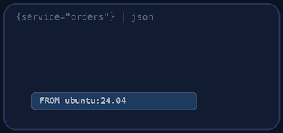
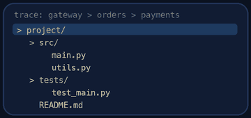
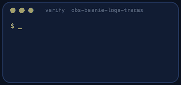
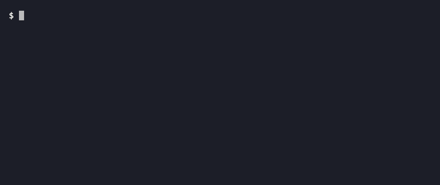

<p align="center"></p>

| | |
|-|-|
| **Time** | 150-180 min |
| **Cost** | free on your own machine (Docker with about 6 GB of memory) |
| **You need** | Docker with Compose v2, git, curl, Python 3 and a terminal |

## How this lab works

1. **Fork** this repository to your own GitHub account (button at the top right).
2. Clone **your fork** in your Ubuntu environment (WSL on Windows, your OrbStack machine on Mac).
3. Read the lab below (the same text is in [`LAB.md`](LAB.md)) and follow the mission.
4. Answer the questions in [`SUBMISSION.md`](SUBMISSION.md). Where a question asks for output, paste it in a code block. No screenshots needed.
5. Commit and push. Open the **Actions** tab of your fork (click *I understand my workflows, go ahead and enable them* the first time). The **Lab check** shows what is still missing.
6. When the check is green, **submit the URL of your fork** in the course platform.

> [!NOTE]
> The check only looks at your answers and any files the lab asks you to commit. Your instructor reads your work and may ask you to explain any line.

<p align="center"></p>

## 🎬 The situation

<p align="center"></p>

A customer writes: *"I ordered a flat white at 10:42, the page hung for a long time, then it said my payment failed. I was charged anyway?"* Behind that one sentence there are five services, a database and a payment provider. Your dashboard says the error rate is fine. Your metrics tell you that **something** is slower than usual, but not **which request**, not **which service** and not **why**.

Metrics answer "is it broken, and how much?". To answer "what happened to *this* request?" you need the other two signals: **logs** (what each service said while handling it) and **traces** (the path of the request through the services, with the time spent in each). Today you build the pipeline for both and join them by one identifier, so that from a single log line you can open the trace, and from a slow span you can open the logs.

> [!IMPORTANT]
> **Your mission**
> - Start Beanie (it logs one JSON object per line and emits OpenTelemetry traces)
> - Collect the logs of all containers into **Loki** with **Alloy**, with the right labels and nothing that explodes cardinality
> - Send the traces through an **OpenTelemetry Collector** to **Tempo**
> - Provision Grafana so that a log line links to its trace and a span links to its logs
> - Slow payments down on purpose and find the slow span of one order
> - Tear it all down and prove it

**Time:** 150-180 min | **Cost:** free on your own machine | **You need:** Docker with Compose v2 (about 6 GB of memory), git, curl, Python 3 and a terminal.

<p align="center"></p>

## Part 0 - What Beanie gives you

Fork this repository, clone your fork and run `./setup.sh`. Then start Beanie alone and look at one request:

```bash
docker compose -f compose.beanie.yaml up -d
curl -s -X POST localhost:8000/api/orders -H 'Content-Type: application/json' \
  -d '{"customer": "Ana", "items": [{"item_id": "flat-white", "quantity": 2}]}'
docker compose -f compose.beanie.yaml logs gateway orders payments --no-log-prefix | tail -12
```

Each line is a JSON object with `ts`, `level`, `service`, `msg`, `trace_id` and `span_id`, and the access line of each request (`"msg": "request"`) also has a `request_id`. Find the **same `trace_id`** in the logs of several services. That identifier is the thread you will pull. (`request_id` identifies one HTTP request; the `trace_id` identifies the whole order as it travels through the services.)

> [!NOTE]
> **Think** `request_id` is unique for every request. If you made it a Loki **label**, what would happen to the number of streams after a day of traffic? (Loki indexes labels, not the log text: that is both its strength and its one big rule.)

<p align="center"></p>

## Part 1 - The back end

<p align="center"></p>

Write `compose.observability.yaml` (the comments say exactly what): **Loki** (log storage), **Tempo** (trace storage), the **OpenTelemetry Collector** (receives spans from the services and forwards them) and **Alloy** (reads the containers' logs and ships them to Loki). The configuration of Loki and Tempo is provided; read it, they are short.

Then copy `.env.example` to `.env` and fill in `OTEL_ENDPOINT`: the address, inside the Compose network, where Beanie must send OTLP/HTTP spans. Compose reads `.env` by itself, which is how the same Beanie file serves a lab with tracing and one without.

<p align="center"></p>

## Part 2 - Logs: from container to Loki

Write `alloy/config.alloy` (five components, listed in its comments). Start everything:

```bash
docker compose -f compose.beanie.yaml -f compose.grafana.yaml -f compose.observability.yaml up -d
```

Alloy's own UI (http://localhost:12345, if you published the port) shows the pipeline as a graph. Then ask Loki, with the API or in Grafana (Explore > Loki):

```text
{service="orders"} | json | level="info"
{service=~".+"} |= "flat-white"
```

Take the `trace_id` of one of your orders (from the `order created` line of the orders service) and run:

```text
{service=~".+"} |= "<that trace_id>"
```

You should see the lines of several services, in order. That is the whole order, from every angle.

> [!NOTE]
> **Predict** Which fields of the log line did you make labels in `stage.labels`, and which stayed in the text? What does `| json` do at query time, and what does it cost compared with a label?

<p align="center"></p>

## Part 3 - Traces: the Collector and Tempo

Write `otel/collector.yaml` (receivers, processors, exporters, one pipeline). The `memory_limiter` comes **first** in the chain: its job is to refuse data before the Collector itself runs out of memory. Restart Beanie so it picks up `.env`, place an order, and then look in Tempo:

```bash
curl -s "localhost:3200/api/search?tags=service.name%3Dgateway&limit=5" | python3 -m json.tool | head -30
```

Open the trace by id (`/api/traces/<traceID>`) and count the services in it. The structure is a tree: the gateway's server span has a child span for each outgoing call, and so on down.

> [!NOTE]
> **Think** Why does the application send to a Collector and not straight to Tempo? Name two things you can do in the Collector without touching or redeploying five services (batching, retries, sampling, filtering, adding attributes, sending the same data to two back ends).

<p align="center"></p>

## Part 4 - Join them

Provision Grafana's data sources (`grafana/provisioning/datasources/loki.yml` and `tempo.yml`, see the comments). In **Loki** a *derived field* turns the `trace_id` in a log line into a link to Tempo. In **Tempo**, *trace to logs* does the opposite. Restart Grafana, open Explore, run `{service="gateway"}`, click a log line and use **View trace**; then from the trace use **Logs for this span**.

Note that Grafana expands `${...}` in provisioning files, so a literal `${__value.raw}` is written `$${__value.raw}`.

> [!NOTE]
> **Predict** The join works because both sides contain the same value. Where does Beanie get the `trace_id` it prints, and what would the logs show for a request that arrived without any tracing configured?

<p align="center"></p>

## Part 5 - The slow order

Make payments slow, then place an order:

```bash
docker compose -f compose.beanie.yaml -f compose.grafana.yaml -f compose.observability.yaml exec payments python -c \
  "import urllib.request as u;u.urlopen(u.Request('http://127.0.0.1:8003/chaos',b'{\"latency_ms\":3000}',{'Content-Type':'application/json'},method='PUT')).read()"
time curl -s -X POST localhost:8000/api/orders -H 'Content-Type: application/json' \
  -d '{"customer": "Slow", "items": [{"item_id": "flat-white", "quantity": 1}]}'
```

Do the 3 a.m. investigation with only Grafana: find the slow trace by duration (Tempo search, `minDuration`), open it, read the waterfall, and name the slowest span and its service. Click through to the logs of that span. Then set the latency back to 0.

> [!NOTE]
> **Think** With metrics alone you would see "orders latency is up" on a dashboard. What would you not have known: which request, which downstream, and what the payment service logged while it waited?

<p align="center"></p>

## Part 6 - Prove it

<p align="center"></p>

```bash
./verify.sh
```

It reads Loki, Tempo and Grafana through their APIs. It places an order and follows its `trace_id` across services, finds the trace by the same id in Tempo, tests your derived-field regex against a real log line, checks the provisioned data sources and links, then slows payments down and checks that the slow span is found in the right service. It takes about 6 minutes. Fix what is red and run it again until it ends with **ALL CHECKS PASSED**.

> [!TIP]
> **Stuck?** No labels in Loki: Alloy cannot read the Docker socket, or the filter matches no container (look at Alloy's logs). `level` missing: `stage.labels` runs after `stage.json`. No traces: `.env` was changed after Beanie started (recreate the containers), or the Collector's receiver is on the wrong port. Traces in the Collector logs but not in Tempo: the exporter endpoint. The derived field does nothing: the regular expression must match the JSON text exactly. Look at a real line in Explore (Beanie writes `"trace_id": "..."`, with a space after the colon) and test your expression against it. Tempo `permission denied` on `/var/tempo`: the lab runs it as root for the volume.

<p align="center"></p>

## Level up (optional)

- Add a `spanmetrics` connector to the Collector and get request-rate metrics out of the traces, into Prometheus.
- Add tail-based sampling: keep every slow or failed trace and 10% of the rest. What do you lose by sampling at the application instead?
- Write a LogQL metric query, `sum by (service) (rate({service=~".+"} | json | level="error" [5m]))`, and put it on a dashboard next to the request rate.
- Put the `trace_id` in the HTTP response header of the gateway. What does the customer's support ticket look like now?

<!-- teardown:start (generated by labs.py, do not edit) -->
## Tear down (mandatory)

<p align="center"></p>

Resources left behind cost money, keep doors open and pollute the next lab. Removing what you created is part of the job, so it is part of the submission: **you must prove it is gone**.

Do this **last**, after you have pasted your `verify` output into `SUBMISSION.md` (once you tear down, the lab can no longer be verified).

1. Run `./teardown.sh`. It removes the containers, networks and volumes of the lab, the local image and the cloned Beanie source.

Then run the proof:

```bash
./verify-teardown.sh
```

It prints a list of checks and must end with **TEARDOWN VERIFIED**. If it reports leftovers, remove them and run it again. Paste the full output in your submission.
<!-- teardown:end -->

<!-- submission:start (generated by labs.py, do not edit) -->
## 📬 Submission

Answer the questions in `SUBMISSION.md` in **your fork** (paste output in code blocks where asked), push, then submit the **URL of your fork**.

**Files to commit**

- `compose.observability.yaml`: Loki, Tempo, the OpenTelemetry Collector and Alloy
- `alloy/config.alloy`, `otel/collector.yaml`, `.env`
- `grafana/provisioning/datasources/loki.yml` and `tempo.yml`

**Questions to answer**

1. Paste your Alloy configuration. In your own words, trace one log line from a container to Loki: which component discovers the container, which reads the log, which parses the JSON, which writes? Which fields became labels and which stayed in the line, and why must `request_id` NOT be a label?
2. Place one order and paste the LogQL query that shows every log line of that order across the services, and the services it touched. How did you get the `trace_id`, and what is the difference between a `request_id` and a `trace_id`?
3. Paste your Collector pipeline (receivers, processors, exporters). Why does the application send to a Collector and not straight to Tempo? Name two things the Collector can do that the app cannot.
4. Slow payments down (`latency_ms` 3000) and place an order. Paste the trace id, the duration of the trace and the name and duration of the slowest span. How would you have found this with metrics alone, and what would you have missed?
5. Paste the configuration that lets you jump from a log line to its trace in Grafana. Which field joins the two worlds, and where does Beanie put it?
6. Logs, metrics, traces: for each of these three questions say which signal you start with, and why: "is it broken?", "where is it broken?", "why is this one request slow?".
7. Paste the output of `./verify.sh`. It must end with **ALL CHECKS PASSED**.
8. **Tear down.** Paste the output of `./verify-teardown.sh`. It must end with **TEARDOWN VERIFIED**.
<!-- submission:end -->
